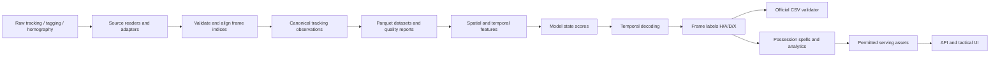

# Data Flow and Lineage — Football Intelligence Platform

**Status:** Partially implemented — Phase 1.2 (synthetic ingestion locally tested). Real Metrica ingestion, Parquet storage, feature engineering, inference, and serving are planned.

## Purpose and scope

This document describes how raw football tracking assets will become validated, aligned observations, model inputs, possession predictions, and permitted analytics/replay assets. It distinguishes implemented capabilities from target architecture. The competition inference pipeline must remain independently runnable without the API or frontend.

## End-to-end data flow



**Current implementation boundary:** Synthetic DataFrame → `iter_tracking_frames()` → validated `TrackingFrame` objects. The official baseline scorer was separately executed in the upstream challenge repository. The remaining flow is planned.

## Data sources and conventions

| Source | Intended use | Constraints / hazards |
|---|---|---|
| Tactical ATD (XML + TXT, loaded via Kloppy) | Primary player and ball tracking | Frame IDs start at 1; missing ball/player positions; track slots are not stable identities |
| Tactical video | Frame-index reference; optional authorized debugging | Licensed/restricted footage |
| Smart Tagging XML | Phase, team, restart priors | Automated and noisy; timestamps in seconds from tactical video start |
| Tactical homography CSV | Project normalized pitch positions to pixels | Zero-based frame index; check `valid` and reprojection error |
| Broadcast footage, tracking and homography | Optional complementary evidence | Separate timeline; never assume frame alignment with tactical source |
| Public five-minute ground truth | Evaluate and diagnose predictions | 7,500 graded frames, 17 possession spells; not representative of full match |
| Synthetic tracking fixtures | Public tests and development | Fabricated data only; not evidence of real match/model performance |

For BAR-ATH, the tactical recording has **199,319 frames at 25 fps**. Submission frame IDs range from `0` to `199318`. The official ground truth labels `H` (home possession), `A` (away possession), `D` (dead ball), or `X` (abstain/ungraded context). The private full-match ground truth is not available to participants.

## Canonical domain contracts — implemented in Phase 1.1

Source: `src/football_intelligence/tracking/models.py`.

- `MatchMetadata`: match identifier, team names, FPS, expected frame count, and pitch dimensions.
- `RecordingSource`: `tactical`, `broadcast`, `synthetic`.
- `TeamSide`: `H` or `A`.
- `PitchPosition`: finite normalized coordinates; spatial outliers outside `[0, 1]` are preserved for quality analysis.
- `PlayerObservation`: numeric track slot, team, optional position, optional nonnegative speed magnitude in m/s. A track slot **does not** identify a stable player.
- `BallObservation`: optional position and optional speed magnitude.
- `TrackingFrame`: `match_id`, `source`, zero-based `frame`, available players and ball; rejects duplicate slots within the same frame.
- `PossessionPrediction` (in `domain.py`): output label, frame, model version, and optional confidence. This is an output contract, not an implemented inference model.

**Logical frame identity:** `(match_id, source, frame)`. Frames from different recording sources are not interchangeable. `None` denotes missing positions in canonical models; analytical storage will encode missing values as nulls. Structural errors are rejected; unusual but finite positions are retained and flagged later.

## Alignment contracts — implemented in Phase 1.1

Source: `src/football_intelligence/tracking/alignment.py`.

- ATD `frame_id` is **one-based**, so `video_frame = frame_id - 1`.
- Canonical video frame and submission row index are **zero-based**.
- Smart Tagging: `round(seconds * fps)` on the tactical recording timeline (future ingestion adapter).
- Homography `frame` is already zero-based (future ingestion adapter).
- Broadcast has its own clock and is not aligned by frame number (future research task).
- Existing sequence checks require contiguous ATD IDs and an expected count. Current ingestion iterator assumes a sequence starting at ATD ID 1; chunked reads need an explicit starting-ID contract.

## Synthetic ingestion — implemented in Phase 1.2

Sources:
- `src/football_intelligence/tracking/synthetic.py`
- `src/football_intelligence/tracking/ingestion.py`
- `tests/test_ingestion.py`

### Synthetic fixture generator

`generate_tracking_table(n_frames, missing_ball_every)` builds a deterministic Pandas DataFrame with documented Metrica-like column names: `frame_id`, `ball_x`, `ball_y`, and `1_x`, `1_y`, `1_s`, etc. It generates two example track slots, simple motion, and intentionally missing ball observations (`NaN`). It is a **test fixture**, not a realistic match simulation.

### Tabular ingestion adapter

- `optional_number`: maps `None`/`NaN` to `None`, rejects nonnumeric or infinite inputs.
- `optional_position`: converts two numeric coordinates to `PitchPosition`; two missing values become `None`; one missing coordinate causes an error.
- `find_track_slots`: discovers numeric track-slot identifiers from `_x`, `_y`, `_s` columns.
- `normalize_record`: turns one Metrica-shaped table row into a canonical `TrackingFrame`, including `frame_id - 1`, available players, missing-ball handling, and an explicit slot-to-team mapping.
- `iter_tracking_frames`: validates column-name types and sequential frame IDs, then yields normalized frame objects. Since Pandas types record keys broadly, a checked type cast is used after verifying all column names are strings.

**Important team-mapping boundary:** the current adapter requires `slot_teams` to be supplied. It does not infer team membership from the numeric slot identifier; that mapping must be extracted and verified from official tracking metadata in the future real-data adapter.

**Important performance boundary:** the current adapter uses `table.to_dict(orient="records")`, which materializes rows in Python memory. It is appropriate for small test fixtures, not yet the desired full-match processing path. Phase 1.3 / real-data integration should introduce batch-aware storage and ingestion.

### Current test coverage

Tests cover deterministic synthetic ingestion, ball missingness, incomplete coordinates, missing slot-to-team mapping, gaps in frame sequences, and individual-record frame alignment. Phase 1.1 also tests basic tracking-model invariants. These tests validate *our implementation*, not compatibility with the as-yet-unavailable licensed tracking bundle.

## Planned pipeline stages

### 1. Official source loading and source provenance

Read the Metrica ATD XML/TXT pair using the official-supported Kloppy loader or verified adapter; extract track-slot team mapping from metadata. Read Smart Tagging and homography separately. Record source fingerprint, source and schema versions; preserve original files unchanged. Fail or explicitly report corrupt/unsupported records rather than silently dropping them.

### 2. Canonical storage (Phase 1.3)

Persist normalized observations to Parquet for efficient analytical work. Prefer separate frame-level and player-level tables rather than serializing nested Python objects as opaque fields. Use DuckDB to query frame counts, ball visibility, player coverage, and quality summaries. Include `match_id`, `source`, `frame`, relevant observations, provenance/version metadata, and nullability conventions.

### 3. Data quality (Phase 1.4)

Check expected frame counts, sequence continuity, duplicate observations, coordinate outliers, slot availability, missing-ball runs, tracking coverage by period and source, Smart Tagging coverage, homography validity, and any source join failures. Report metrics without silently repairing or deleting unusual samples.

### 4. Feature extraction

Compute distances to the ball, relative motion, density, reliability of recent tracking, tactical phase priors, time since last ball observation, and candidate restart signals. Distinguish source data and computed features. Do not leak private labels or unavailable data. Offline bidirectional temporal context may be possible if allowed and explicitly documented.

### 5. Possession inference and decoding

Generate raw per-state scores separately from final `H/A/D/X` decisions. Apply temporal decoding to represent sustained possession and meaningful transitions; preserve raw and decoded results under model/version identifiers.

### 6. Competition validation and analytics

Export exactly 199,319 ordered rows as `frame,label`, then run the official `evaluation/validate_submission.py`. Measure public-ground-truth performance with explicit sample-scope caveats. Derive possession spells as maximal contiguous `H` or `A` intervals; split spells on dead-ball frames, switches, and half boundaries. Use start-inclusive/end-exclusive intervals in internal analytics. `X` handling must be explicitly defined in the analytics and not confused with the official scorer's forward-fill behavior.

### 7. Public serving boundary

Only serve licensed/allowed, synthetic, or independently permitted data. The public API and replay must not publish competition video clips, original or reconstructable frame-level tracking exports, or protected derivatives.

## Data lineage manifest — proposed

```json
{
  "run_id": "synthetic-demo-example",
  "source_fingerprint": "sha256:<digest>",
  "git_commit": "<commit-sha>",
  "config_hash": "sha256:<digest>",
  "feature_schema_version": "v1",
  "model_version": "baseline-v0",
  "prediction_hash": "sha256:<digest>",
  "data_access": "synthetic"
}
```

This is a **schema example**, not evidence of an executed production inference run. Version and hash transformations so outputs can be reproduced from immutable inputs and configurations.

## Failure and recovery principles

- Fail early on structural contract violations; record source, stage, frame context, and diagnostic message.
- Distinguish an expected missing detection from a malformed numeric input.
- Keep source files immutable and produce new artifacts for each transformation/version.
- Prefer deterministic, rerunnable stages with explicit input fingerprints and configuration.
- Keep restricted intermediate datasets and error reports outside the public repository and CI.

## Implemented versus planned — current checkpoint

| Capability | Status |
|---|---|
| Official public-baseline scorer execution | Verified separately in Metrica repository |
| Domain models and structural validation | Implemented, locally tested (P1.1) |
| ATD/video frame conversion | Implemented, locally tested (P1.1) |
| Synthetic table generator | Implemented, locally tested (P1.2) |
| Pandas-table ingestion adapter | Implemented, locally tested (P1.2) |
| Source metadata team mapping | Planned; not yet verified with real data |
| Official XML/TXT ingestion | Planned; needs licensed assets |
| Parquet / DuckDB analytical storage | Planned (P1.3) |
| Data quality report | Planned (P1.4) |
| Feature engineering / possession model | Planned |
| API / interactive tactical replay | Planned |

## Competition data restrictions

Competition assets require enrollment and acceptance of the data terms. Do not put licensed files, video, frame-level tracking, or reconstructive derivatives in the public repository. Do not upload restricted competition data or extracts to third-party hosted/cloud LLMs. Cloud processing and public display depend on the applicable data terms. Public CI uses synthetic fixtures only.

## References

- [Official challenge DATA.md](https://github.com/metrica-sports/more-than-a-hack-2027/blob/main/DATA.md)
- [Official ATD loader](https://github.com/metrica-sports/more-than-a-hack-2027/blob/main/starter/load_atd.py)
- [Official Smart Tagging loader](https://github.com/metrica-sports/more-than-a-hack-2027/blob/main/starter/load_smart_tagging.py)
- [Official homography loader](https://github.com/metrica-sports/more-than-a-hack-2027/blob/main/starter/load_homography.py)
- [Official evaluation details](https://github.com/metrica-sports/more-than-a-hack-2027/blob/main/EVALUATION.md)
