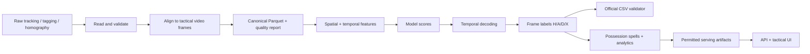

# Data Flow and Lineage — Football Intelligence Platform

**Status:** Planned v0.1. The official reference scorer has been executed; production ingest/inference pipelines are not yet implemented.

## Data flow


## Source inventory
| Source | Use | Hazard |
|---|---|---|
| Tactical automatic tracking (ATD) | Authoritative per-frame player/ball observations | Ball missing ~41% of graded frames, fragmented track slots |
| Tactical video | Authoritative frame index; optional research context | Competition-restricted material |
| Smart Tagging | Team/phase priors and restart clues | Noisy automatic inference, not ground truth |
| Homography | Convert pitch-to-pixel and coordinate systems | Explicit validity flag; coordinate convention matters |
| Broadcast video/tracking | Optional second input | Different timeline, cuts/replays, not directly frame-aligned |
| Public 5-minute ground truth | Test scorer and diagnose models | Only 17 possessions; cannot replace full-match evaluation |

## Stage contracts and validation
### 1. Read source
Output: parsed source records with source hash, source-relative timestamp/frame, and schema version. Reject corrupt records or report coverage without silently dropping them.

### 2. Align to tactical index
Reference: tactical frames **0..199318** at **25 fps**. Preserve unmapped/missing observations with explicit quality flags. Broadcast alignment is a separate optional research task, not an early dependency.

### 3. Canonical intermediate data
Suggested fields: `match_id`, `frame`, `half`, `ball_visible`, `ball_x`, `ball_y`, `team_observations`, `tracking_quality`, `homography_valid`, tagging signals. Confirm source units/coordinate conventions from `DATA.md` and real assets before finalizing storage format.

### 4. Feature generation
Compute distance-to-ball by team, relative movements, density, transitions, time since last reliable ball observation, and restart priors. Use windows that do not accidentally leak labels or unavailable inference-time information. For offline full-match processing, bidirectional context is technically possible if rule-compliant and documented.

### 5. Model inference and temporal decoding
Store per-state scores separately from final labels. Temporal decoding penalizes flicker, estimates possession boundaries, and represents stoppages. Preserve both raw and decoded predictions for experiment analysis.

### 6. Evaluation and export
Create `frame,label` exactly once per video frame, with labels in `{H,A,D,X}`. Run `evaluation/validate_submission.py` on final file. Evaluate against the *public* reference only with explicit sample scope; official private benchmark cannot be independently replicated.

### 7. Derive spans for UI
Turn frame labels into maximal `H` and `A` runs; end a spell on `D`, another team, or match boundary. Store frame intervals start-inclusive/end-exclusive. Separate dead-ball spans. Keep every artifact linked to `run_id` and model version.

## Lineage manifest (suggested)
```json
{
  "run_id": "example-synthetic-only",
  "source_fingerprint": "sha256:...",
  "git_commit": "...",
  "config_hash": "sha256:...",
  "feature_schema_version": "v1",
  "model_version": "baseline-v0",
  "prediction_hash": "sha256:...",
  "data_access": "restricted-or-public"
}
```
This is a schema example, not evidence of an actual run.

## Quality gates
- Expected record count and sequential video frames.
- No duplicate frame IDs or unannounced frame shifts.
- Sanity checks for coordinates and tracking validity.
- Missing-ball rates by half/period; tracking slot and tagging coverage.
- Model output length/label validity/non-null final CSV.
- Replay chunks use permitted data only; never expose restricted reconstructive tracking exports.

## Failure and recovery approach
Fail before export on contract violations; emit stage error + lineages; rerun idempotent stages using stable input/config hashes; retain interim reports (private when they include restricted data).

## Legal boundaries
Data access terms control whether storage, third-party processing, publishing, or cloud hosting are allowed. By default public repo and CI use synthetic data only; do not send restricted competition data or extracts to hosted/cloud LLMs.
