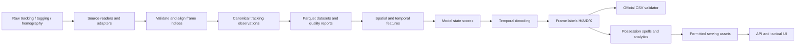

# Data Flow and Lineage — Football Intelligence Platform

**Status:** Partially implemented — Phase 1.2 (synthetic ingestion locally tested). Real Metrica ingestion, Parquet storage, feature engineering, inference, and serving are planned.

## Purpose and scope

This document describes how raw football tracking assets will become validated, aligned observations, model inputs, possession predictions, and permitted analytics/replay assets. It distinguishes implemented capabilities from target architecture. The competition inference pipeline must remain independently runnable without the API or frontend.

## End-to-end data flow



**Current implementation boundary:** Synthetic DataFrame → `iter_tracking_frames()` → validated `TrackingFrame` objects. The official baseline scorer was separately executed in the upstream challenge repository. The remaining flow is planned.

## Data sources and conventions

| Source | Intended use | Constraints / hazards |
|---|---|---|
| Tactical ATD (XML + TXT, loaded via Kloppy) | Primary player and ball tracking | Frame IDs start at 1; missing ball/player positions; track slots are not stable identities |
| Tactical video | Frame-index reference; optional authorized debugging | Licensed/restricted footage |
| Smart Tagging XML | Phase, team, restart priors | Automated and noisy; timestamps in seconds from tactical video start |
| Tactical homography CSV | Project normalized pitch positions to pixels | Zero-based frame index; check `valid` and reprojection error |
| Broadcast footage, tracking and homography | Optional complementary evidence | Separate timeline; never assume frame alignment with tactical source |
| Public five-minute ground truth | Evaluate and diagnose predictions | 7,500 graded frames, 17 possession spells; not representative of full match |
| Synthetic tracking fixtures | Public tests and development | Fabricated data only; not evidence of real match/model performance |

For BAR-ATH, the tactical recording has **199,319 frames at 25 fps**. Submission frame IDs range from `0` to `199318`. The official ground truth labels `H` (home possession), `A` (away possession), `D` (dead ball), or `X` (abstain/ungraded context). The private full-match ground truth is not available to participants.

## Canonical domain contracts — implemented in Phase 1.1

Source: `src/football_intelligence/tracking/models.py`.

- `MatchMetadata`: match identifier, team names, FPS, expected frame count, and pitch dimensions.
- `RecordingSource`: `tactical`, `broadcast`, `synthetic`.
- `TeamSide`: `H` or `A`.
- `PitchPosition`: finite normalized coordinates; spatial outliers outside `[0, 1]` are preserved for quality analysis.
- `PlayerObservation`: numeric track slot, team, optional position, optional nonnegative speed magnitude in m/s. A track slot **does not** identify a stable player.
- `BallObservation`: optional position and optional speed magnitude.
- `TrackingFrame`: `match_id`, `source`, zero-based `frame`, available players and ball; rejects duplicate slots within the same frame.
- `PossessionPrediction` (in `domain.py`): output label, frame, model version, and optional confidence. This is an output contract, not an implemented inference model.

**Logical frame identity:** `(match_id, source, frame)`. Frames from different recording sources are not interchangeable. `None` denotes missing positions in canonical models; analytical storage will encode missing values as nulls. Structural errors are rejected; unusual but finite positions are retained and flagged later.

## Alignment contracts — implemented in Phase 1.1

Source: `src/football_intelligence/tracking/alignment.py`.

- ATD `frame_id` is **one-based**, so `video_frame = frame_id - 1`.
- Canonical video frame and submission row index are **zero-based**.
- Smart Tagging: `round(seconds * fps)` on the tactical recording timeline (future ingestion adapter).
- Homography `frame` is already zero-based (future ingestion adapter).
- Broadcast has its own clock and is not aligned by frame number (future research task).
- Existing sequence checks require contiguous ATD IDs and an expected count. Current ingestion iterator assumes a sequence starting at ATD ID 1; chunked reads need an explicit starting-ID contract.

## Synthetic ingestion — implemented in Phase 1.2

Sources:
- `src/football_intelligence/tracking/synthetic.py`
- `src/football_intelligence/tracking/ingestion.py`
- `tests/test_ingestion.py`

### Synthetic fixture generator

`generate_tracking_table(n_frames, missing_ball_every)` builds a deterministic Pandas DataFrame with documented Metrica-like column names: `frame_id`, `ball_x`, `ball_y`, and `1_x`, `1_y`, `1_s`, etc. It generates two example track slots, simple motion, and intentionally missing ball observations (`NaN`). It is a **test fixture**, not a realistic match simulation.

### Tabular ingestion adapter

- `optional_number`: maps `None`/`NaN` to `None`, rejects nonnumeric or infinite inputs.
- `optional_position`: converts two numeric coordinates to `PitchPosition`; two missing values become `None`; one missing coordinate causes an error.
- `find_track_slots`: discovers numeric track-slot identifiers from `_x`, `_y`, `_s` columns.
- `normalize_record`: turns one Metrica-shaped table row into a canonical `TrackingFrame`, including `frame_id - 1`, available players, missing-ball handling, and an explicit slot-to-team mapping.
- `iter_tracking_frames`: validates column-name types and sequential frame IDs, then yields normalized frame objects. Since Pandas types record keys broadly, a checked type cast is used after verifying all column names are strings.

**Important team-mapping boundary:** the current adapter requires `slot_teams` to be supplied. It does not infer team membership from the numeric slot identifier; that mapping must be extracted and verified from official tracking metadata in the future real-data adapter.

**Important performance boundary:** the current adapter uses `table.to_dict(orient="records")`, which materializes rows in Python memory. It is appropriate for small test fixtures, not yet the desired full-match processing path. Phase 1.3 / real-data integration should introduce batch-aware storage and ingestion.

### Current test coverage

Tests cover deterministic synthetic ingestion, ball missingness, incomplete coordinates, missing slot-to-team mapping, gaps in frame sequences, and individual-record frame alignment. Phase 1.1 also tests basic tracking-model invariants. These tests validate *our implementation*, not compatibility with the as-yet-unavailable licensed tracking bundle.

## Analytical Storage — Phase 1.3

### Purpose

The analytical storage layer provides persistent, structured, and queryable storage for canonical football tracking observations.

After ingestion and normalization, tracking data is serialized into Apache Parquet files. DuckDB is used to execute analytical SQL queries directly against those files without requiring a separate database server.

The primary objectives are:

- Persist validated tracking observations beyond application execution.
- Preserve the canonical data model through serialization and deserialization.
- Support efficient analytical queries over frame and player observations.
- Establish a reusable data foundation for feature engineering, possession inference, and match visualization.
- Separate source-data ingestion from downstream analytical processing.

### Storage Architecture

The platform uses two Parquet datasets:

**1. Frame observations — `frames.parquet`**

One record per tracking frame.

| Column | Data type | Description |
|---|---|---|
| `match_id` | String | Match identifier |
| `source` | String | Recording source |
| `frame` | Int64 | Zero-based frame identifier |
| `ball_x` | Float64, nullable | Normalized ball X coordinate |
| `ball_y` | Float64, nullable | Normalized ball Y coordinate |
| `ball_speed_mps` | Float64, nullable | Ball speed in meters per second |

**2. Player observations — `players.parquet`**

One record per player track-slot observation within a frame.

| Column | Data type | Description |
|---|---|---|
| `match_id` | String | Match identifier |
| `source` | String | Recording source |
| `frame` | Int64 | Zero-based frame identifier |
| `track_slot` | Int64 | Source tracking slot |
| `team` | String | Home (`H`) or away (`A`) |
| `x` | Float64, nullable | Normalized player X coordinate |
| `y` | Float64, nullable | Normalized player Y coordinate |
| `speed_mps` | Float64, nullable | Player speed in meters per second |

The logical identity of a frame is `(match_id, source, frame)`.

Player observations are identified by `(match_id, source, frame, track_slot)`.

The datasets are linked through the shared frame identity.

### Serialization and Deserialization

The storage implementation is located in:

`src/football_intelligence/tracking/storage.py`

It provides two public functions:

**`write_tracking_parquet()`**

- Accepts canonical `TrackingFrame` objects.
- Separates frame-level and player-level observations.
- Serializes data using explicit PyArrow schemas.
- Uses Zstandard compression.
- Preserves missing observations as null values.
- Rejects duplicate frame identities.
- Creates `frames.parquet` and `players.parquet`.

**`read_tracking_parquet()`**

- Reads both Parquet datasets.
- Reconstructs canonical Pydantic tracking objects.
- Restores player observations to their corresponding frames.
- Preserves nullable positions and speeds.
- Rejects duplicate frame identities and orphan player observations.

Serialization is verified through round-trip tests:

`TrackingFrame → Parquet → TrackingFrame`

For valid datasets, reconstructed objects must equal their original canonical representations.

### Analytical Querying

The analytical implementation is located in:

`src/football_intelligence/tracking/analytics.py`

DuckDB queries the Parquet files directly using an in-memory database connection.

The initial `tracking_summary()` function calculates:

- Total stored frames.
- Frames containing ball position observations.
- Frames missing ball position observations.
- Player observations containing valid positions.

This approach supports analytical operations without reconstructing all tracking records into Python objects.

DuckDB will also support future feature engineering, temporal analytics, player movement statistics, and AI dataset preparation.

### End-to-End Demonstration

The demonstration script is located at:

`scripts/demo_storage.py`

The workflow is:

1. Generate deterministic synthetic tracking records.
2. Normalize records into canonical `TrackingFrame` objects.
3. Persist frame and player observations to Parquet.
4. Query the stored datasets using DuckDB.
5. Display tracking coverage metrics.

Generated files are stored under:

`datasets/generated/demo/`

For the standard 100-frame synthetic example, the expected results are:

| Metric | Expected value |
|---|---:|
| Total frames | 100 |
| Ball-visible frames | 80 |
| Missing-ball frames | 20 |
| Tracked player observations | 200 |

These values describe synthetic test data, not actual competition observations.

### Validation and Testing

The storage layer includes automated tests for:

- Parquet file creation.
- Serialization/deserialization consistency.
- Preservation of missing ball positions.
- Empty dataset handling.
- Duplicate frame rejection.
- DuckDB analytical query correctness.

The implementation is validated locally using pytest, Ruff, and mypy.

### Data Governance

Generated and restricted datasets must remain outside public version control.

The following directories are excluded through `.gitignore`:

- `datasets/generated/`
- `datasets/raw/`

Source code, tests, documentation, and reproducible synthetic generators may be committed.

Official competition data and restricted derived assets must not be uploaded to the public repository.

### Current Limitations

The initial implementation is designed for local development and controlled datasets.

The following capabilities are not yet implemented:

- Streaming serialization for full-match datasets.
- Partitioned Parquet storage.
- Atomic dataset publication.
- Dataset versioning and lifecycle management.
- Cloud object storage integration.
- Full-match performance profiling.
- Production-oriented analytical query optimization.

Storage schema versioning and reproducibility metadata are introduced separately in Phase 1.4 through the lineage manifest.

### Implementation Status

**Completed and locally verified:**

- Explicit Parquet schemas for frames and players.
- Canonical tracking serialization and deserialization.
- Zstandard-compressed Parquet storage.
- Direct DuckDB analytical queries.
- Automated storage and analytics tests.
- End-to-end synthetic tracking demonstration.

**Pending:**

- Full-match scalability verification.
- Integration with authorized Metrica tracking datasets.
- Production storage optimization and cloud integration.

Phase 1.3 establishes the persistent analytical foundation for subsequent data quality, feature engineering, AI inference, and visualization components.


## Data Quality & Lineage — Phase 1.4

### Purpose

The tracking data quality layer evaluates whether persisted observations are complete, temporally consistent and spatially plausible before downstream feature engineering or AI inference.

Quality checks operate against the Parquet storage layer using DuckDB. They are diagnostic and must not silently modify tracking observations.

### Quality measurements

**Coverage**
- Total stored frames.
- Frames with missing ball coordinates.
- Ball tracking coverage percentage.
- Tracked player observations.
- Player observations with missing positions.

**Temporal integrity**
- Missing frame identifiers between observed frames.
- Number of frame gaps.
- Duplicate frame identifiers.
- Duplicate player observations.
- Player observations without corresponding frame records.

**Spatial diagnostics**
- Ball observations outside configured pitch boundaries.
- Player observations outside configured pitch boundaries.
- Player speeds above a configurable threshold.

Spatial thresholds are initial assumptions and must be verified against actual Metrica coordinate conventions and units.

### Lineage

Every quality run can produce a lineage manifest containing:

- Storage schema version.
- Manifest creation timestamp in UTC.
- Source description.
- Optional Git commit identifier.
- Quality-check configuration.
- SHA-256 fingerprints and sizes of input Parquet files.

This allows the system to identify the exact stored input files used during quality analysis.

The manifest does not yet capture the complete upstream transformation history.

### Report outputs

The reporting layer produces:

- `quality.json` for software consumers.
- `quality.md` for human inspection.

Reports are stored locally under `datasets/generated/` and excluded from version control.

### Limitations

The current quality layer operates on local Parquet datasets and does not yet include production data quality orchestration.

Temporal gap detection does not verify the expected first and last frames of a recording.

Quality thresholds are configurable diagnostics, not official competition validation rules.

Actual Metrica data compatibility remains unverified until the licensed source files are available.

## Real Metrica Data Integration — Phase 1.5

### Purpose

Phase 1.5 connects the Football Intelligence Platform's canonical tracking pipeline to actual Metrica Sports EPTS tracking datasets.

The objective is to support real football tracking observations without changing the existing ingestion, storage, analytics, and data quality architecture.

The integration is designed around an adapter that converts provider-specific data into the standardized input representation established in Phase 1.2.

### Source Format

The Metrica tactical tracking dataset is distributed using the EPTS (Electronic Performance and Tracking Systems) format.

The expected source consists of:

- An XML metadata file describing the tracking dataset.
- A TXT file containing time-series tracking observations.

The integration uses the Kloppy Python library to parse EPTS data and produce a Pandas DataFrame.

The tactical recording is the reference timeline for tracking observations.

Source frame identifiers are one-based. The canonical application uses zero-based frame identifiers.

The existing alignment utilities perform this conversion.

### Metrica Adapter

The implementation is located at:

`src/football_intelligence/tracking/metrica.py`

The module provides two principal functions.

**`load_metrica_epts()`**

- Validates that the source files exist.
- Loads EPTS tracking data using Kloppy.
- Converts the loaded dataset into a Pandas DataFrame.
- Supports optional sample limits.
- Verifies the existence of the `frame_id` column.
- Returns a DataFrame with normalized tracking column names.

**`normalize_metrica_columns()`**

- Standardizes supported track-slot naming conventions.
- Maps columns such as `Track_1_x` to `1_x`.
- Preserves ball observation columns.
- Detects conflicting column names created during normalization.
- Produces a schema compatible with the existing ingestion adapter.

The adapter isolates Metrica-specific conventions from the internal canonical tracking models.

### Canonical Data Flow

The intended real-data workflow is:

1. Load authorized EPTS XML and TXT files through Kloppy.
2. Inspect and normalize tracking columns.
3. Resolve track-slot team membership using verified source metadata.
4. Convert source observations into canonical `TrackingFrame` objects.
5. Align source frame identifiers with the zero-based tactical-video timeline.
6. Persist canonical frame and player observations to Parquet.
7. Run analytical queries and data quality checks using DuckDB.
8. Generate quality reports and lineage metadata for the processed dataset.

The pipeline reuses the implementations developed during Phases 1.1–1.4.

### Track-Slot Identity and Team Mapping

Tracking slots represent source observation channels and must not be assumed to correspond to permanent player identities.

Track-slot numbers must not be interpreted as team assignments without supporting metadata.

Canonical `PlayerObservation` objects require explicit home or away team membership.

A verified mapping between source track slots and team membership must be established before real-match ingestion.

Unknown or ambiguous team assignments must not be silently guessed.

Actual mapping behavior and stability across frames remain subject to verification against the authorized dataset.

### Inspection Tool

The inspection script is located at:

`scripts/inspect_metrica.py`

It accepts paths to the EPTS metadata and tracking files.

Its purpose is to inspect:

- Loaded row and column counts.
- Available tracking column names.
- Source frame identifiers.
- Sample DataFrame structure.
- Source conventions relevant to canonical ingestion.

The script is intended for local inspection of authorized data.

Restricted match observations and files must not be committed or publicly redistributed.

### Validation Strategy

**Tests available without the real dataset:**

- Supported column-name normalization.
- Detection of conflicting normalized column names.
- Compatibility with the existing DataFrame ingestion adapter.
- One-based to zero-based frame conversion.
- Handling of missing ball observations.
- Rejection of missing source files.

**Verification requiring authorized Metrica files:**

- Successful loading of the actual EPTS XML/TXT pair.
- Actual source schema compatibility.
- Metadata extraction and track-slot team mapping.
- Frame count and frame alignment verification.
- Full-match Parquet serialization.
- Real-data quality analysis and anomaly investigation.
- End-to-end lineage reporting.

Synthetic and mocked tests validate the adapter's expected behavior but do not establish compatibility with the actual competition files.

### Data Governance

Official competition datasets remain subject to their applicable access and usage restrictions.

Source files and restricted derived tracking observations must remain outside the public Git repository.

The `datasets/raw/` and `datasets/generated/` directories are excluded from version control.

Only source code, synthetic fixtures, tests, and permitted documentation should be published.

### Current Limitations

The initial adapter does not yet resolve team membership automatically from actual EPTS metadata.

Real source schema conventions and metadata structures have not been verified.

Full-match memory usage, ingestion performance, and Parquet output sizes have not yet been measured.

The initial implementation uses an in-memory DataFrame and canonical-object conversion. Streaming or chunked processing may be introduced following real-dataset profiling.

### Implementation Status

**Preparatory implementation:**

- Kloppy integration and EPTS loading interface.
- Tracking column normalization.
- Source file validation.
- Compatibility tests using synthetic DataFrames.
- Local inspection script.

These components are considered implemented only after their corresponding code and automated tests pass.

**Pending real-data verification:**

- Access to the authorized Metrica tracking dataset.
- Validation against actual EPTS files.
- Verified track-slot team mapping.
- Full-match ingestion, Parquet storage, and quality reporting.
- Frame alignment and source metadata verification.
- End-to-end performance and data integrity assessment.

**Phase 1.5 status: In progress — awaiting real-data verification.**

Phase 1 will be considered complete only after the authorized real-match integration has been successfully validated.

## Planned pipeline stages

### 1. Official source loading and source provenance

Read the Metrica ATD XML/TXT pair using the official-supported Kloppy loader or verified adapter; extract track-slot team mapping from metadata. Read Smart Tagging and homography separately. Record source fingerprint, source and schema versions; preserve original files unchanged. Fail or explicitly report corrupt/unsupported records rather than silently dropping them.

### 2. Canonical storage (Phase 1.3)

Persist normalized observations to Parquet for efficient analytical work. Prefer separate frame-level and player-level tables rather than serializing nested Python objects as opaque fields. Use DuckDB to query frame counts, ball visibility, player coverage, and quality summaries. Include `match_id`, `source`, `frame`, relevant observations, provenance/version metadata, and nullability conventions.

### 3. Data quality (Phase 1.4)

Check expected frame counts, sequence continuity, duplicate observations, coordinate outliers, slot availability, missing-ball runs, tracking coverage by period and source, Smart Tagging coverage, homography validity, and any source join failures. Report metrics without silently repairing or deleting unusual samples.

### 4. Feature extraction

Compute distances to the ball, relative motion, density, reliability of recent tracking, tactical phase priors, time since last ball observation, and candidate restart signals. Distinguish source data and computed features. Do not leak private labels or unavailable data. Offline bidirectional temporal context may be possible if allowed and explicitly documented.

### 5. Possession inference and decoding

Generate raw per-state scores separately from final `H/A/D/X` decisions. Apply temporal decoding to represent sustained possession and meaningful transitions; preserve raw and decoded results under model/version identifiers.

### 6. Competition validation and analytics

Export exactly 199,319 ordered rows as `frame,label`, then run the official `evaluation/validate_submission.py`. Measure public-ground-truth performance with explicit sample-scope caveats. Derive possession spells as maximal contiguous `H` or `A` intervals; split spells on dead-ball frames, switches, and half boundaries. Use start-inclusive/end-exclusive intervals in internal analytics. `X` handling must be explicitly defined in the analytics and not confused with the official scorer's forward-fill behavior.

### 7. Public serving boundary

Only serve licensed/allowed, synthetic, or independently permitted data. The public API and replay must not publish competition video clips, original or reconstructable frame-level tracking exports, or protected derivatives.

## Data lineage manifest — proposed

```json
{
  "run_id": "synthetic-demo-example",
  "source_fingerprint": "sha256:<digest>",
  "git_commit": "<commit-sha>",
  "config_hash": "sha256:<digest>",
  "feature_schema_version": "v1",
  "model_version": "baseline-v0",
  "prediction_hash": "sha256:<digest>",
  "data_access": "synthetic"
}
```

This is a **schema example**, not evidence of an executed production inference run. Version and hash transformations so outputs can be reproduced from immutable inputs and configurations.

## Failure and recovery principles

- Fail early on structural contract violations; record source, stage, frame context, and diagnostic message.
- Distinguish an expected missing detection from a malformed numeric input.
- Keep source files immutable and produce new artifacts for each transformation/version.
- Prefer deterministic, rerunnable stages with explicit input fingerprints and configuration.
- Keep restricted intermediate datasets and error reports outside the public repository and CI.

## Implemented versus planned — current checkpoint

| Capability | Status |
|---|---|
| Official public-baseline scorer execution | Verified separately in Metrica repository |
| Domain models and structural validation | Implemented, locally tested (P1.1) |
| ATD/video frame conversion | Implemented, locally tested (P1.1) |
| Synthetic table generator | Implemented, locally tested (P1.2) |
| Pandas-table ingestion adapter | Implemented, locally tested (P1.2) |
| Source metadata team mapping | Planned; not yet verified with real data |
| Official XML/TXT ingestion | Planned; needs licensed assets |
| Parquet / DuckDB analytical storage | Planned (P1.3) |
| Data quality report | Planned (P1.4) |
| Feature engineering / possession model | Planned |
| API / interactive tactical replay | Planned |

## Competition data restrictions

Competition assets require enrollment and acceptance of the data terms. Do not put licensed files, video, frame-level tracking, or reconstructive derivatives in the public repository. Do not upload restricted competition data or extracts to third-party hosted/cloud LLMs. Cloud processing and public display depend on the applicable data terms. Public CI uses synthetic fixtures only.

## References

- [Official challenge DATA.md](https://github.com/metrica-sports/more-than-a-hack-2027/blob/main/DATA.md)
- [Official ATD loader](https://github.com/metrica-sports/more-than-a-hack-2027/blob/main/starter/load_atd.py)
- [Official Smart Tagging loader](https://github.com/metrica-sports/more-than-a-hack-2027/blob/main/starter/load_smart_tagging.py)
- [Official homography loader](https://github.com/metrica-sports/more-than-a-hack-2027/blob/main/starter/load_homography.py)
- [Official evaluation details](https://github.com/metrica-sports/more-than-a-hack-2027/blob/main/EVALUATION.md)
