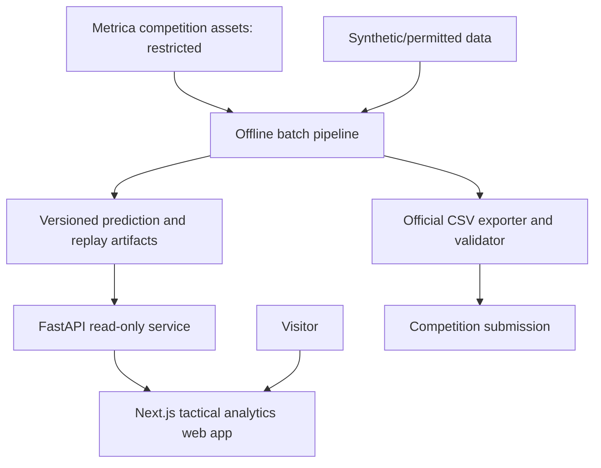

# System Architecture — Football Intelligence Platform

**Status:** Target architecture v0.1. Components marked **planned** do not yet exist.

## Architectural style
**Modular monolith + independent batch ML pipeline**, in one monorepo. Domain and analytics modules share explicit typed contracts; no internal network calls or distributed queues are required. UI is a separate Next.js application, API is one FastAPI application, and inference jobs can run as offline CLI workflows.

## Context diagram


## Boundaries and responsibilities
| Component | Responsibility | Depends on | Current state |
|---|---|---|---|
| `core` | Prediction label enum, frame/spell schemas, shared invariants | Pydantic / standard library | Basic model implemented |
| `data` | Source adapters, schema validation, frame/time alignment, data quality | `core` | Planned |
| `features` | Deterministic spatial/temporal features | `core`, `data` | Planned |
| `intelligence` | Baselines, ML inference, temporal decoding | `core`, `features` | Planned |
| `analytics` | Possession segmentation, summaries, evaluation context | `core`, prediction output | Planned |
| `pipelines` | CLI orchestration, manifests, exporting | All offline modules | Planned |
| `api` | Read-only match/prediction/replay endpoints | Serving datastore | Planned |
| `web` | Match overview, timeline, tactical canvas, model lab | API | Planned |
| `infra` | CI, images, optional cloud provisioning/monitoring | Deployable components | CI file created; deploy planned |

## Storage design
- **Restricted raw assets**: local paths outside Git; do not redistribute.
- **Canonical tracking/features**: compressed partitioned Parquet with schema/version/quality manifests; DuckDB for local analytics (planned).
- **Predictions / derived results**: versioned offline artifacts keyed by match, run, model, config and source fingerprint.
- **Serving database**: PostgreSQL for match/experiment metadata and indices; store compact allowed replay chunks in permitted object storage (planned).
- **Experiment metadata**: MLflow or small local manifest first; adopt MLflow when experiments justify it.

## Proposed domain contracts
```text
Match(id, home_team, away_team, fps, reference_frame_count, source_license)
Frame(match_id, frame_number, timestamp_ms, half)
TrackingFrame(match_id, frame_number, ball_observation?, team_observations, quality_flags)
FeatureFrame(match_id, frame_number, feature_schema_version, values)
Prediction(match_id, frame_number, H|A|D|X, model_version, confidence?, run_id)
Spell(match_id, start_frame, end_frame_exclusive, H|A, run_id)
InferenceRun(run_id, input_fingerprint, git_commit, config_hash, model_version, output_hash)
```
`D` is a dead-ball period, not a possession spell. `X` is an abstention; scorer applies special fill logic before measuring `spellF1`. Choose inclusive-start/exclusive-end intervals internally and test conversions carefully.

## CLI/API boundary
**Competition path:** input assets -> `uv run ...` offline pipeline -> per-frame predictions -> validated `frame,label` CSV. No runtime requirement for API, DB, frontend, cloud or network.

**Product path:** versioned allowed artifacts -> API -> app state and canvas renderer. Heavy model inference is not triggered by page navigation.

## Technology decisions
- **Now:** Python 3.11, `uv`, Pydantic, NumPy/Pandas, pytest, Ruff, mypy, GitHub Actions.
- **Phase 1:** Polars (if useful), Parquet, DuckDB, source-adapter tests.
- **Phase 2:** scikit-learn/LightGBM, PyTorch only for justified temporal experiments; MLflow/Optuna as required.
- **Post-submission:** FastAPI, PostgreSQL, Next.js/TypeScript, PixiJS or Canvas, Docker, Terraform, possible AWS deployment.
- **Not now:** Kafka, Kubernetes, Java service, live inference infrastructure.

## Cross-cutting concerns
**Reproducibility:** lockfile, pinned official scorer commit, seeded model training, config files, deterministic export, hash checks.

**Quality:** schemas and data validation, unit tests for label/spell semantics and boundaries, integration tests on synthetic fixtures, CLI smoke test.

**Security and licensing:** private restricted files excluded by `.gitignore`; synthetic fixtures in public CI; never publish reconstructive derived match data; review enrollment terms before cloud processing or demo distribution.

**Observability:** structured pipeline logs, runtime and data-quality metrics; tracing and dashboards later, when services exist.

## Deployment states
1. Local offline CLI (immediate).
2. Local API + browser UI fed by synthetic/permitted artifacts (product MVP).
3. Public containerized app with scoped data access and automated deployments (later).

## Open design questions
- Source tracking schema/field semantics after October 20.
- Best temporal algorithm and how to estimate confidence.
- Public/demo dataset licensing and whether a privately hosted viewer is allowed.
- Final public hosting budget and infrastructure constraints.
